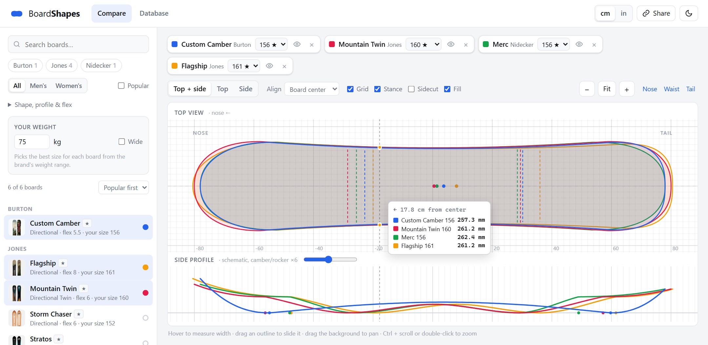
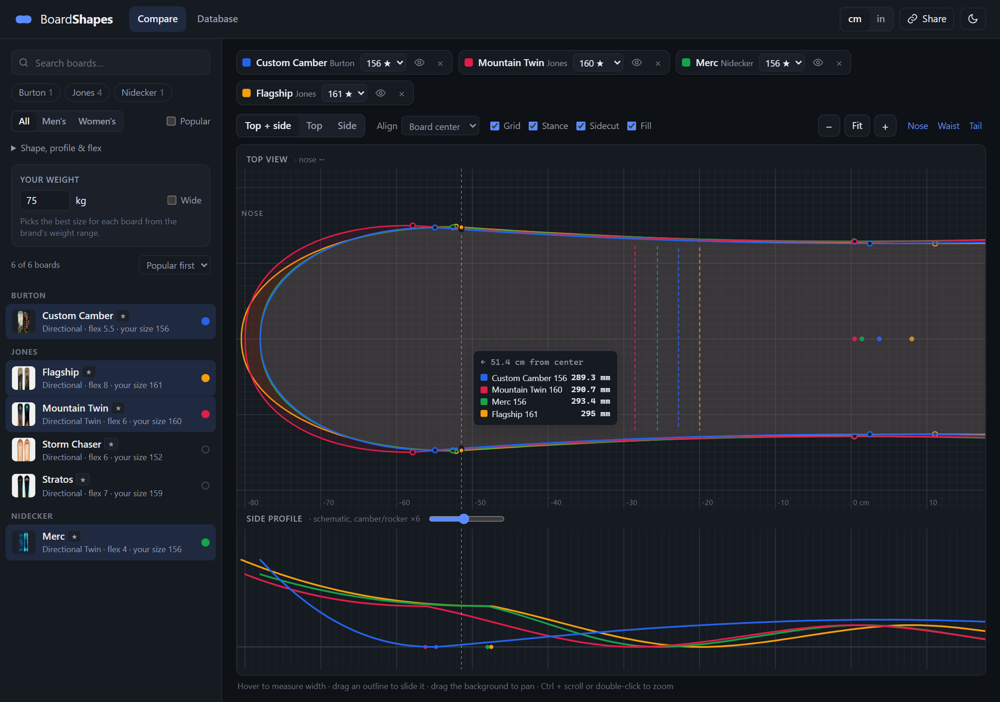
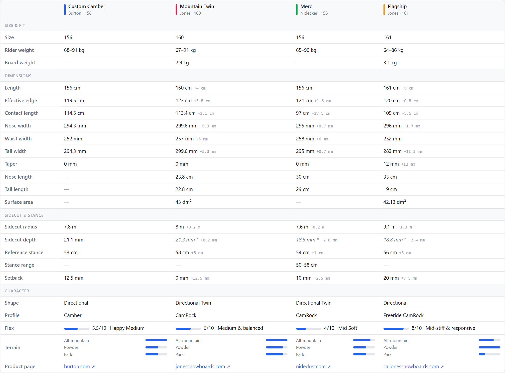
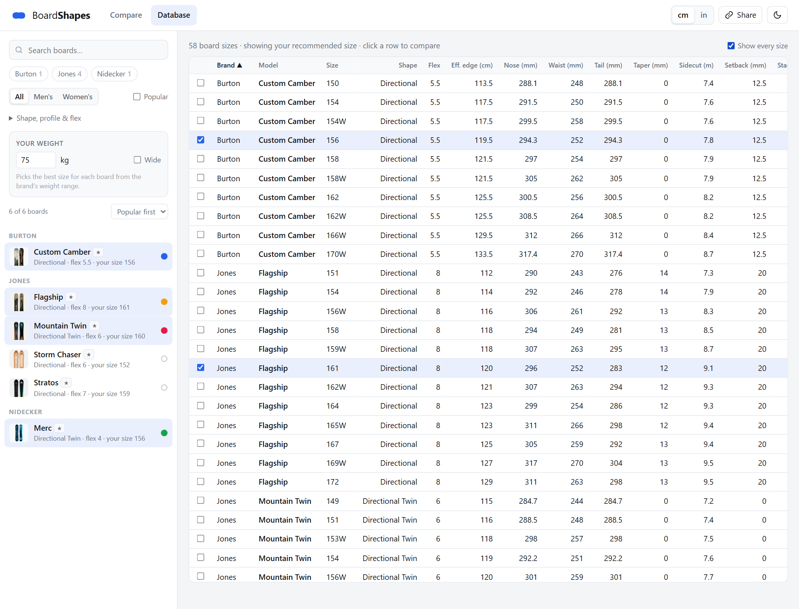

# BoardShapes

Overlay and compare snowboard outlines and size charts, in the spirit of mouse-shape comparison
sites. The outlines are rebuilt from the specs that Burton, Jones and Nidecker publish.

**▶ [Open BoardShapes](https://joshualunali.github.io/boardshapes/)** (runs in your browser, nothing to install)

[](https://joshualunali.github.io/boardshapes/#c=burton-custom-camber:156,jones-mountain-twin:160,nidecker-merc:156,jones-flagship:161&w=75)

<sub>Click the image to open this exact comparison: Custom Camber, Mountain Twin, Merc and Flagship
for a 75 kg rider.</sub>

## What you can do

- **Overlay outlines to scale.** Line boards up by board center, stance center, waist, nose or
  tail. Toggle the grid, stance markers, sidecut points and fill.
- **Measure.** Hover anywhere along the length to read every board's width at that point.
- **Move around.** Drag an outline to slide it (double-click it to snap back), and drag the
  background to pan. Zoom with Ctrl + scroll, double-click (Shift + double-click zooms out), the
  − / + buttons, or the **Nose / Waist / Tail** presets.
- **See the profile.** A schematic camber/rocker side view shares the top view's scale, with
  adjustable exaggeration.
- **Get your size.** Enter your weight (and tick **Wide** for big boots), and each board is set
  to its best size from the brand's weight range.
- **Compare the numbers.** A spec table lists every published dimension, with the difference
  from the first board.
- **Browse the database.** A sortable table of every board, or every size. Click a row to add
  it to the comparison.
- **Filter and share.** Filter by brand, men's/women's, shape, profile type and flex. Switch
  between cm and inches, and light and dark themes. The URL always holds the current comparison,
  so the **Share** button copies a link that reopens it.



<sub>Dark theme, zoomed to the noses, with sidecut markers on.</sub>

### Spec table



### Database



## How the outlines are drawn

The outlines are calculated from the published numbers, not traced from photos
(see [`assets/geometry.js`](assets/geometry.js)).

- **To scale, from the specs:** total length; nose, waist and tail widths; sidecut radius (drawn
  as a circular arc, deepest at the waist); taper; setback (measured from the middle of the
  sidecut); and reference stance.
- **Approximated:** the curve of the nose and tail tips (its bluntness depends on the board's
  shape), and the side profile, which is a schematic drawn from the profile type. Burton
  doesn't publish nose and tail lengths, so for Burton boards the split between nose and tail is
  estimated from the shape.

Values in the spec table that were estimated rather than published are shown in italics with
a `*`. Always check the brand's own size chart before you buy.

## Running it locally

There's no build step and no server needed. Clone the repo and open `index.html` in a browser.
The data ships as `data/boards.js`, so it works straight from disk.

```
git clone https://github.com/joshualunali/boardshapes.git
```

## Adding boards and updating the data

The data is built by [`scraper/scrape.py`](scraper/scrape.py). It needs Python 3 and nothing
else (it uses `curl` if it's installed). It reads each product page's size chart and writes
`data/boards.json` and `data/boards.js`.

### Recommended: import pages saved from your browser

The brand sites rate-limit automated requests, so this is the most reliable way:

1. Open a board's product page on burton.com, jonessnowboards.com or nidecker.com.
2. Press **Ctrl+S**, choose **Webpage, HTML Only**, and save it into `scraper/saved/`.
3. Run:
   ```
   python scraper/scrape.py --import-dir scraper/saved
   ```
4. Reload the page (Ctrl+F5).

The brand is detected from the page itself. Imported boards are merged into the existing data,
replacing any existing copy of the same board. If a page reports `no spec table`, save it again as
**Webpage, Complete**.

### Automatic scraping

```
python scraper/scrape.py                  # crawl every brand's catalogue
python scraper/scrape.py --brand jones    # one brand only
python scraper/scrape.py --offline        # re-parse cached pages, no network
```

Requests are spaced several seconds apart and respect the sites' `Retry-After` headers.
Downloaded pages are cached in `scraper/cache/`, so an interrupted run carries on where it
stopped. If a site blocks the scraper completely, that brand's existing boards are kept.

> **Note:** if a run collects only *some* of a brand's boards, it replaces that brand's boards
> with just those. Run the `--import-dir` command again afterwards to restore any boards you
> imported by hand.

### Fixing data by hand

[`scraper/overrides.json`](scraper/overrides.json) lets you correct any field of a board, or
tune how its tips are drawn (for example, adding a swallowtail). It's applied on every run.

### What each brand publishes

| Spec | Burton | Jones | Nidecker |
|---|:-:|:-:|:-:|
| Nose / waist / tail width | ✓ | ✓ | ✓ |
| Sidecut radius | ✓ | ✓ | ✓ |
| Effective edge, contact length | ✓ | ✓ | ✓ |
| Nose / tail length (tip to contact point) | – | ✓ | ✓ |
| Setback, reference stance | ✓ | ✓ | ✓ |
| Stance range | – | – | ✓ |
| Rider weight range | ✓ | ✓ | ✓ |
| Board weight, surface area | – | ✓ | – |
| Profile, flex, terrain ratings | ✓ | ✓ | ✓ |
| Shape | ✓ | ✓ | inferred |
| Riding level | ✓ | – | – |

### Updating the live site

GitHub Pages serves the site from the `main` branch. After importing new boards, commit
`data/boards.json`, `data/boards.js` and the saved pages, then push. The site updates within a
minute or two.

## Project layout

```
index.html               page structure
assets/style.css         styles (light/dark themes, responsive layout)
assets/geometry.js       rebuilds outlines and side profiles from the specs
assets/app.js            the UI: list, filters, overlay, spec table, database, shareable URL
data/boards.json         board data (generated by the scraper)
data/boards.js           the same data as a script, so the page works from disk (generated)
scraper/scrape.py        scraper and importer
scraper/overrides.json   manual corrections
scraper/saved/           saved product pages the current data was built from
docs/images/             screenshots used in this README
```

## Disclaimer

BoardShapes is an independent project and isn't affiliated with Burton, Jones or Nidecker.
Board names, specs and product images belong to their brands. Images are loaded from the brands'
own sites, not copied into this repo. Outlines are approximations built from published specs.
